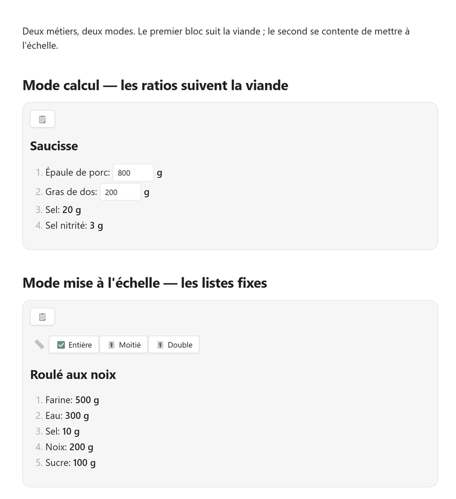

# kitchenForge

[](https://github.com/e1fueg0/kitchen-forge/releases/latest)
[](https://github.com/e1fueg0/kitchen-forge/actions/workflows/ci.yml)
[](https://obsidian.md)
[](LICENSE)

[English](README.md) · **Français**

Je fais de la charcuterie maison. Je cuisine aussi des recettes qui ne sont pas de la charcuterie. Ce sont deux façons de cuisiner, et elles demandent deux modes différents.

- **La charcuterie se construit avec des ratios.** Le sel, le nitrite, le poivre et les épices sont dosés par rapport au poids de viande. Quand le poids de viande change, tous les additifs doivent suivre.
- **Les pâtes à gâteau, les crèmes, les soupes et la plupart des recettes du quotidien sont des listes fixes.** Pour faire la moitié, on multiplie chaque quantité par `0,5`.

kitchenForge réunit les deux dans Obsidian sous forme de bloc `kitchenforge`. Les deux modes interactifs sont exclusifs : un bloc utilise le mode calcul, le mode mise à l'échelle, ou aucun des deux — jamais les deux à la fois.



*Animation réelle d'Obsidian : les deux modes, thème clair.*

## Les deux modes en un coup d'œil

| Votre recette est… | Utilisez | Ce que vous modifiez |
|---|---|---|
| Saucisse, charcuterie, saumure, tout ce qui est construit avec des ratios | **Mode calcul** (`id` + `calc`) | Les poids de base ; les quantités dépendantes se recalculent en direct |
| Pâte, gâteau, sauce, soupe, une liste d'ingrédients fixe | **Mode mise à l'échelle** (`scales`) | Rien ; cliquez sur un bouton d'échelle |

> Un bloc ne peut pas mélanger `scales` avec `id`/`calc`. kitchenForge affiche une erreur au lieu de deviner.

## Mode calcul : des ratios qui suivent la viande

Marquez les ingrédients que vous voulez modifier avec un `id`. Tout ingrédient qui possède une expression `calc` peut référencer ces ids. L'expression est évaluée à l'affichage du bloc, puis à chaque modification d'un champ. Les ids doivent être uniques dans toute la recette : ce sont des noms de variables partagés.

````markdown
```kitchenforge
unit: g
sections:
  - name: 🥩 Viande
    items:
      - name: Porc
        id: porc
        value: 800

      - name: Lard gras
        id: lard
        value: 200

  - name: 🧂 Assaisonnement
    items:
      - name: Sel
        calc: (porc + lard) @ 20

      - name: Poivre noir
        calc: (porc + lard) @ 1.5
```
````

Pour 1000 g de viande, cela affiche **20 g** de sel et **1,5 g** de poivre. Passez `porc` à `1000` : le sel devient **24 g**, le poivre **1,8 g** — sans toucher aux lignes d'assaisonnement.

> Dans le YAML, le séparateur décimal est le point (`1.5`), même en français.

### L'opérateur `@` : pour mille

```text
a @ b = a × b / 1000
```

Ainsi, `1000 @ 20` signifie **20 pour 1000**, et non 20 %. `@ 20` correspond à 2 %, `@ 1.5` à 0,15 %. Le résultat reste dans l'unité de l'opérande de gauche : des grammes en entrée, des grammes en sortie.

`@` a la même priorité que `*` et `/`. Utilisez des parenthèses quand l'expression n'est pas évidente.

### Recette de saucisse complète

````markdown
```kitchenforge
unit: g
sections:
  - name: 🥩 Matières premières
    items:
      - name: Porc mi-gras
        id: porc
        value: 800

      - name: Lard gras
        id: lard
        value: 200

  - name: 🧂 Épices et aromates
    items:
      - name: Sel nitrité (0,6 % NaNO₂)
        calc: (porc + lard) @ 20

      - name: Poivre noir moulu
        calc: (porc + lard) @ 1.5

      - name: Noix de muscade
        calc: (porc + lard) @ .5

      - name: Sucre
        calc: (porc + lard) @ 1.5

      - name: Ail séché
        calc: (porc + lard) @ 5

      - name: Lait en poudre
        calc: (porc + lard) @ 5

      - name: Eau glacée
        calc: porc @ 15
```
````

> **Sécurité alimentaire :** ces valeurs sont un exemple, pas une norme de salaison. Utilisez une recette testée et le pourcentage de nitrite exigé par la réglementation locale.

## Mode mise à l'échelle : des listes fixes, en un clic

Fournissez une liste `scales` et des ingrédients simples avec des `value` fixes. Chaque échelle a un `name` et un multiplicateur `mult`. Cliquer sur un bouton multiplie toutes les quantités par ce multiplicateur.

Chaque clic s'applique aux quantités **d'origine**, pas aux valeurs affichées. Passer d'une échelle à l'autre n'est donc pas destructif : `Complet → Moitié → Complet` restaure exactement la recette d'origine.

````markdown
```kitchenforge
unit: g
decimals: 1
scales:
  - name: Complet
    mult: 1
  - name: Moitié
    mult: .5
  - name: Tiers
    mult: .33
sections:
  - name: 🥣 Pâte
    items:
      - name: Farine
        value: 400

      - name: Beurre
        value: 140

      - name: Jaunes d'œufs
        value: 2
        unit: u

      - name: Crème fraîche épaisse
        value: 160

      - name: Sel
        value: 5

  - name: 🌰 Garniture
    items:
      - name: Noix moulues
        value: 80

      - name: Sucre glace
        value: 40
```
````

### Quelle échelle est sélectionnée au départ ?

- La **première échelle de la liste** est sélectionnée à l'affichage, quel que soit son `mult`. Si la première échelle est `Moitié`, la recette s'ouvre déjà divisée par deux.
- Si **aucune** échelle n'a `mult: 1`, kitchenForge ajoute un bouton implicite `💯 1:1` à la **fin** de la rangée. La première échelle définie par l'utilisateur reste sélectionnée au départ.
- Si une échelle a déjà `mult: 1`, aucun bouton implicite n'est ajouté.

Le libellé `📏` précède la rangée de boutons. Le bouton sélectionné commence par `✅`, les autres par `🎚`.

## Arrondis

`decimals` contrôle le nombre de décimales pour les valeurs calculées et mises à l'échelle. La valeur par défaut est `2`.

Un `round: N` sur un ingrédient force l'arrondi au multiple de `N` le plus proche. C'est pratique pour les ingrédients où les décimales n'ont pas de sens (pommes de terre au `25` g près) ou pour les unités entières (œufs avec `round: 1`).

```yaml
- name: Pomme de terre
  value: 150
  round: 25      # pas de 25 g ; ex. 49,5 → 50

- name: Œuf
  value: 1
  unit: u
  round: 1       # une demi-recette affiche encore 1, pas 0
```

Une quantité non nulle ne devient jamais `0` : elle reste au minimum à un pas, dans le même sens, donc une division ne peut pas faire disparaître un ingrédient. Un `round` nul ou négatif revient à l'arrondi normal avec `decimals`.

`round: 1` sur un ingrédient important mais peu nombreux (œufs, sachets) introduit une vraie erreur quand on divise la recette. Dans ce cas, pesez l'ingrédient (1 œuf ≈ 50 g) et utilisez un pas plus petit, par ex. `round: 5` : la mise à l'échelle sera plus honnête.

## Champs

| Champ | Niveau | Obligatoire | Remarques |
|---|---|---|---|
| `unit` | niveau racine | Non | Unité par défaut des ingrédients qui n'en ont pas. `g` par défaut. Affichage uniquement : kitchenForge ne **convertit pas** les unités. |
| `decimals` | niveau racine | Non | Nombre de décimales pour les valeurs calculées et mises à l'échelle. `2` par défaut. |
| `scales[]` | niveau racine | Non | Liste de `{name, mult}`. Incompatible avec les ingrédients `id`/`calc`. |
| `sections[]` | niveau racine | **Oui** | Liste de `{name?, items[]}`. Une section sans nom crée un espace visuel (sauf en haut). |
| `name` | ingrédient | **Oui** | Nom de l'ingrédient. |
| `value` | ingrédient | Oui pour les ingrédients simples et `id` | Nombre. Ignorée si `calc` est présent. |
| `unit` | ingrédient | Non | Remplace l'unité de la recette pour cet ingrédient. Affichage uniquement. |
| `id` | ingrédient | Non | Expose l'ingrédient comme champ modifiable. Les autres ingrédients peuvent le référencer dans `calc`. Nécessite une `value` numérique. Doit être unique dans toute la recette. |
| `calc` | ingrédient | Non | Expression. Opérateurs `+ - * / @` et parenthèses. À utiliser à la place de `value`. |
| `round` | ingrédient | Non | Arrondit la valeur calculée/mise à l'échelle au multiple de ce pas (par ex. `25`, `1`). Remplace `decimals` ; une quantité non nulle ne devient jamais `0`. |

## Copier la recette affichée

Chaque bloc affiché possède un bouton 📋 en haut. Il copie la **recette actuellement affichée** — avec les valeurs calculées ou mises à l'échelle — sous forme de liste Markdown propre. Le bouton devient ✅ pendant une seconde.

C'est pratique pour coller la recette dans une note, une liste de courses ou un message pendant la cuisson. La copie ne modifie jamais votre source YAML. Le bouton n'écrit dans le presse-papiers que lorsqu'on clique dessus ; kitchenForge ne lit jamais son contenu.

## Dépannage

| Message ou symptôme | Cause probable | Correction |
|---|---|---|
| `Recipe must have a 'sections' array` | Le bloc n'a pas de liste `sections` | Ajoutez `sections:` avec au moins une section. |
| `Section '…' must have an 'items' array` | Une section n'a pas de liste `items` | Ajoutez une liste `items:` à cette section. |
| `Unknown variable: …` | `calc` référence un id inexistant ou sans `value` | Ajoutez l'id avec une valeur numérique, ou corrigez l'orthographe. |
| `Duplicate id '…'` | Le même id est utilisé par plusieurs ingrédients | Donnez un id unique à chaque ingrédient. |
| `Cannot have scales with ids/formulas specified` | Modes mélangés | Supprimez `scales`, ou supprimez tous les `id`/`calc`. |
| `Unsupported operator` | Opérateur `%`, `^`, etc. | Utilisez `+ - * / @`. |
| `Error parsing recipe:` | YAML invalide | Vérifiez l'indentation, les deux-points et les guillemets. |
| Une valeur affiche `Infinity` ou `NaN` | Division par zéro ou valeur non numérique | Vérifiez les valeurs saisies et l'expression. |

## Installation

### Plugins communautaires (recommandé)

kitchenForge est disponible dans le répertoire des plugins communautaires d'Obsidian.

1. Ouvrez **Paramètres → Plugins communautaires**.
2. Si le mode restreint est activé, désactivez-le.
3. Cliquez sur **Parcourir**, cherchez **kitchenForge**, puis **Installer** et **Activer**.

Nécessite Obsidian **1.2.3+**. Fonctionne sur ordinateur et mobile.

### Installation manuelle

Téléchargez `main.js`, `manifest.json` et `styles.css` depuis la [dernière version](https://github.com/e1fueg0/kitchen-forge/releases/latest), placez-les dans `<coffre>/.obsidian/plugins/kitchen-forge/`, puis activez le plugin dans **Paramètres → Plugins communautaires**.

## Développement

```sh
npm install
npm run dev      # esbuild en mode watch
npm test         # vitest, 94 tests
npm run lint
npm run build    # vérification TypeScript + bundle de production
```

Les tests couvrent les fonctions pures (`src/recipe.ts`, `src/calc.ts`) et le rendu DOM (`src/kitchenforge.ts`) via `happy-dom`.

## Retour

Un bug ou une idée ? [Ouvrez une issue](https://github.com/e1fueg0/kitchen-forge/issues).

## Licence

MIT. Voir [LICENSE](LICENSE).
