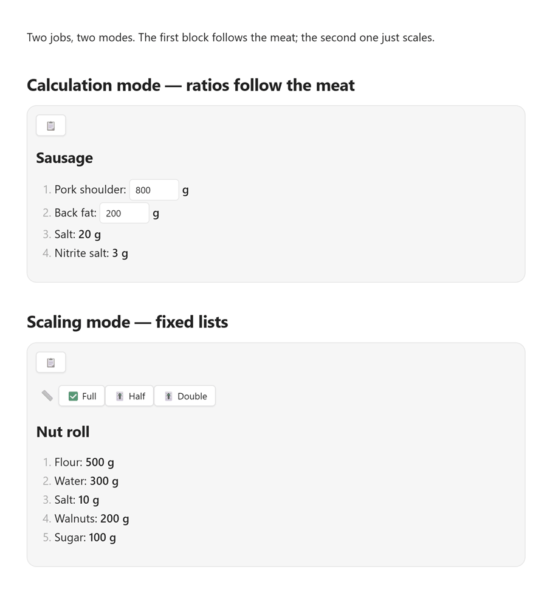

# kitchenForge

[](https://github.com/e1fueg0/kitchen-forge/releases/latest)
[](https://github.com/e1fueg0/kitchen-forge/actions/workflows/ci.yml)
[](https://obsidian.md)
[](LICENSE)

**English** · [Français](README.fr.md)

I make sausage at home. I also cook non-sausage recipes. Those are two different jobs, and they need two different modes.

- **Sausage and charcuterie are built from ratios.** Salt, nitrite, pepper and spices are dosed against the weight of the meat. When the meat changes, every additive has to follow.
- **Dough, batter, soup and most everyday recipes are fixed lists.** To make half, you multiply every amount by `0.5`.

kitchenForge puts both workflows into Obsidian as a fenced `kitchenforge` block. The two interactive modes are mutually exclusive: a block uses calculation mode, scaling mode, or neither — never both.



*Live Obsidian animation: both modes, light theme.*

## Two modes at a glance

| Your recipe is… | Use | What you edit |
|---|---|---|
| Sausage, charcuterie, brine, anything built from ratios | **Calculation mode** (`id` + `calc`) | Base weights; dependent amounts recompute live |
| Dough, cake, sauce, soup, a fixed ingredient list | **Scaling mode** (`scales`) | Nothing; click a scale button |

> A block cannot mix `scales` with `id`/`calc`. kitchenForge reports an error instead of guessing.

## Calculation mode: ratios that follow the meat

Mark the ingredients you want to edit with an `id`. Any ingredient with a `calc` expression can reference those ids. The expression is evaluated when the block renders and again on every input change. IDs must be unique across the whole recipe — they are shared variable names.

````markdown
```kitchenforge
unit: g
sections:
  - name: 🥩 Meat
    items:
      - name: Pork
        id: pork
        value: 800

      - name: Back fat
        id: lard
        value: 200

  - name: 🧂 Seasoning
    items:
      - name: Salt
        calc: (pork + lard) @ 20

      - name: Black pepper
        calc: (pork + lard) @ 1.5
```
````

This renders **20 g** salt and **1.5 g** pepper for 1000 g of meat. Change `pork` to `1000` and the salt becomes **24 g**, the pepper **1.8 g** — no need to touch the seasoning lines.

### The `@` operator is per mille

```text
a @ b = a × b / 1000
```

So `1000 @ 20` means **20 per 1000**, not 20%. `@ 20` is 2%, and `@ 1.5` is 0.15%. The result stays in the same unit as the left operand: grams in, grams out.

`@` has the same precedence as `*` and `/`. Use parentheses when the expression is not obvious.

### Full sausage recipe

````markdown
```kitchenforge
unit: g
sections:
  - name: 🥩 Raw materials
    items:
      - name: Pork (semi-fatty)
        id: pork
        value: 800

      - name: Back fat
        id: lard
        value: 200

  - name: 🧂 Spices and seasonings
    items:
      - name: Nitrite salt (0.6% NaNO₂)
        calc: (pork + lard) @ 20

      - name: Ground black pepper
        calc: (pork + lard) @ 1.5

      - name: Nutmeg
        calc: (pork + lard) @ .5

      - name: Sugar
        calc: (pork + lard) @ 1.5

      - name: Dried garlic
        calc: (pork + lard) @ 5

      - name: Milk powder
        calc: (pork + lard) @ 5

      - name: Iced water
        calc: pork @ 15
```
````

> **Food safety:** these numbers are an example, not a curing standard. Use a tested recipe and the nitrite percentage required by your local food-safety guidance.

## Scaling mode: fixed lists, one click

Provide a `scales` list and plain ingredients with fixed `value`s. Each scale has a `name` and a multiplier `mult`. Clicking a button multiplies every amount by that multiplier.

Every click is applied to the **original** amounts, not to the values currently on screen. Switching between scales is non-destructive: `Full → Half → Full` restores the original recipe exactly.

````markdown
```kitchenforge
unit: g
decimals: 1
scales:
  - name: Full
    mult: 1
  - name: Half
    mult: .5
  - name: Third
    mult: .33
sections:
  - name: 🥣 Dough
    items:
      - name: Flour
        value: 400

      - name: Butter
        value: 140

      - name: Egg yolks
        value: 2
        unit: pcs

      - name: Sour cream
        value: 160

      - name: Salt
        value: 5

  - name: 🌰 Filling
    items:
      - name: Ground nuts
        value: 80

      - name: Powdered sugar
        value: 40
```
````

### Which scale is selected first?

- The **first scale in the list** is selected when the block renders, regardless of its `mult`. If the first scale is `Half`, the recipe opens halved.
- If **no** scale has `mult: 1`, kitchenForge appends an implicit `💯 1:1` button at the **end** of the row. The first user-defined scale is still selected initially.
- If a scale already has `mult: 1`, no implicit button is added.

The `📏` label prefixes the button row. The selected button starts with `✅`; the others start with `🎚`.

## Rounding

`decimals` controls decimal places for computed and scaled values. It defaults to `2`.

Set a per-item `round: N` to snap an amount to the nearest multiple of `N` instead. This is useful for ingredients where decimal precision is just noise (potatoes to the nearest `25` g) or for whole-unit items (eggs with `round: 1`).

```yaml
- name: Potato
  value: 150
  round: 25      # 25 g steps; e.g. 49.5 → 50

- name: Egg
  value: 1
  unit: pcs
  round: 1       # half a recipe still shows 1, not 0
```

A non-zero amount never becomes `0`: it stays at least one step in the same direction, so scaling down cannot make an ingredient disappear. A zero or negative `round` falls back to normal `decimals` rounding.

`round: 1` on a low count of an impactful ingredient (eggs, sachets) introduces real error when scaling. For those, weigh the ingredient (1 egg ≈ 50 g) and use a smaller step, e.g. `round: 5`, so the scale stays honest.

## Fields

| Field | Level | Required | Notes |
|---|---|---|---|
| `unit` | top level | No | Default unit for items that don't override it. Defaults to `g`. Display-only: kitchenForge does **not** convert units. |
| `decimals` | top level | No | Decimal places for computed and scaled amounts. Defaults to `2`. |
| `scales[]` | top level | No | List of `{name, mult}`. Mutually exclusive with `id`/`calc` items. |
| `sections[]` | top level | **Yes** | List of `{name?, items[]}`. A section without a name renders as a visual gap (except at the top). |
| `name` | item | **Yes** | Ingredient name. |
| `value` | item | Yes for plain and `id` items | Number. Ignored when `calc` is present. |
| `unit` | item | No | Overrides the recipe-level unit for this item. Display-only. |
| `id` | item | No | Exposes the item as an editable input. Other items can reference the id in `calc`. Needs a numeric `value`. Must be unique across the whole recipe. |
| `calc` | item | No | Expression. Supports `+ - * / @` and parentheses. Use instead of `value`. |
| `round` | item | No | Snap computed/scaled amount to the nearest multiple of this step (e.g. `25`, `1`). Overrides `decimals`; a non-zero amount never becomes `0`. |

## Copy the current recipe

Every rendered block has a 📋 button at the top. It copies the **currently displayed recipe** — with calculated or scaled values filled in — as a clean Markdown list. The button turns into ✅ for a second.

This is handy for pasting into a note, a shopping list, or a message while cooking. Copying never rewrites your YAML source. The button only writes to the clipboard when clicked; kitchenForge never reads clipboard contents.

## Troubleshooting

| Message or symptom | Likely cause | Fix |
|---|---|---|
| `Recipe must have a 'sections' array` | Missing `sections` | Add `sections:` with at least one section. |
| `Section '…' must have an 'items' array` | A section has no `items` | Add an `items:` list to that section. |
| `Unknown variable: …` | `calc` references an id that does not exist or has no `value` | Add the id with a numeric value, or fix the spelling. |
| `Duplicate id '…'` | The same id is used by more than one item | Give each item a unique id. |
| `Cannot have scales with ids/formulas specified` | Mixed modes | Remove `scales`, or remove every `id`/`calc`. |
| `Unsupported operator` | Used `%`, `^`, etc. | Use `+ - * / @`. |
| `Error parsing recipe:` | Invalid YAML | Check indentation, colons and quotes. |
| A value shows `Infinity` or `NaN` | Division by zero or a non-numeric input | Check the input values and the expression. |

## Installation

### Community plugins (recommended)

kitchenForge is in the Obsidian Community Plugins directory.

1. Open **Settings → Community plugins**.
2. If restricted mode is on, turn it off.
3. Click **Browse**, search for **kitchenForge**, then **Install** and **Enable**.

Requires Obsidian **1.2.3+**. Works on desktop and mobile.

### Manual installation

Download `main.js`, `manifest.json` and `styles.css` from the [latest release](https://github.com/e1fueg0/kitchen-forge/releases/latest), put them into `<vault>/.obsidian/plugins/kitchen-forge/`, then enable the plugin in **Settings → Community plugins**.

## Development

```sh
npm install
npm run dev      # esbuild in watch mode
npm test         # vitest, 94 tests
npm run lint
npm run build    # type-check + production bundle
```

Tests cover the pure helpers (`src/recipe.ts`, `src/calc.ts`) and the DOM-facing renderer (`src/kitchenforge.ts`) via `happy-dom`.

## Feedback

Found a bug or have an idea? [Open an issue](https://github.com/e1fueg0/kitchen-forge/issues).

## License

MIT. See [LICENSE](LICENSE).
